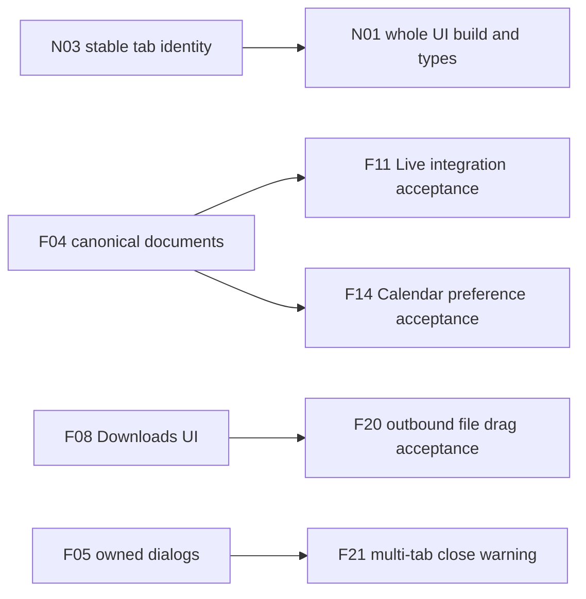

# Linux parity repair plans

These six draft planning PRs hand off36 issues:27 original gaps,3 desktop investigations and6 new upstream integration regressions. [#10 coordination](https://github.com/mckamyk/ardia/issues/10) is the live coordination tracker. Plans describe work and acceptance; they do not implement repairs or close issues.

The Linux branch was rebased onto main `a2ca6bdf8f69ef1b5818525ca79e9d85de2fc962` and published at `6907d6831980c3b6d686ccba0d3abdb8be2d5ebe`. The 311 incoming commits reorganize shared UI/state/platform layers, native domain calls/events, stable tab identity, configuration and Chromium 156. All 30 original findings remain applicable on current-source review. Issue links pin evidence to this rebased source, replacing obsolete pre-rebase paths.

## Validation status

| Check on the rebased source | Result |
| --- | --- |
| Frozen dependency installation | Passed |
| Linux UI production build | Failed on removed shared import paths; N01 |
| Linux typecheck | Failed with 105 errors; N01/N03 and exact Linux signatures |
| Linux host tests | Three test files cannot load removed paths; N01 |
| Native host fixtures |11 passed |
| Native bootstrap |7 passed |
| Linux platform tooling |14 passed;1 stale hardcoded 155 expectation fails; N05 |
| Matching Chromium 156 engine/package | Not built or qualified; N05 |
| Shared browser and demo relative to new main | No application-source changes |

The Linux/shared Helium pins now match 0.20.1 at `f29a25968e483f8bb85e47829ccd487bbe229199`; Helium Linux 0.20.1.1 is pinned at `473c0f72d7db2e8492f0fa975b8544bc719bb027`. This is source alignment, not native build evidence. Historical Chromium 155 native probes do not validate the rebased tree.

## Stack and primary ownership

The PR base chain follows repair/review order. It is not a requirement that all implementation work wait for every lower layer. The issue graph below defines actual completion blockers. Each higher PR adds one workstream document; the first also adds this index and the machine-readable manifest.

| Layer | Workstream | Plan file added by that layer | Primary issues |
| --- | --- | --- | --- |
| 1 | Upstream baseline, capabilities and profile boundaries | `01-upstream-and-capabilities.md` | [#38 N01](https://github.com/mckamyk/ardia/issues/38), [#39 N02](https://github.com/mckamyk/ardia/issues/39), [#40 N03](https://github.com/mckamyk/ardia/issues/40), [#41 N04](https://github.com/mckamyk/ardia/issues/41), [#42 N05](https://github.com/mckamyk/ardia/issues/42), [#43 N06](https://github.com/mckamyk/ardia/issues/43), [#12 F02](https://github.com/mckamyk/ardia/issues/12), [#36 F26](https://github.com/mckamyk/ardia/issues/36) |
| 2 | Everyday page commands and application dialogs | `02-commands-and-dialogs.md` | [#11 F01](https://github.com/mckamyk/ardia/issues/11), [#15 F05](https://github.com/mckamyk/ardia/issues/15), [#33 F23](https://github.com/mckamyk/ardia/issues/33) |
| 3 | Canonical document state and save-before-close | `03-persistent-documents.md` | [#14 F04](https://github.com/mckamyk/ardia/issues/14) |
| 4 | Page events and native browser services | `04-native-events-and-services.md` | [#13 F03](https://github.com/mckamyk/ardia/issues/13), [#16 F06](https://github.com/mckamyk/ardia/issues/16), [#17 F07](https://github.com/mckamyk/ardia/issues/17), [#18 F08](https://github.com/mckamyk/ardia/issues/18), [#19 F09](https://github.com/mckamyk/ardia/issues/19), [#25 F15](https://github.com/mckamyk/ardia/issues/25), [#26 F16](https://github.com/mckamyk/ardia/issues/26), [#27 F17](https://github.com/mckamyk/ardia/issues/27), [#34 F24](https://github.com/mckamyk/ardia/issues/34), [#35 F25](https://github.com/mckamyk/ardia/issues/35) |
| 5 | Integrations, input and shared startup services | `05-integrations-and-input.md` | [#20 F10](https://github.com/mckamyk/ardia/issues/20), [#21 F11](https://github.com/mckamyk/ardia/issues/21), [#22 F12](https://github.com/mckamyk/ardia/issues/22), [#23 F13](https://github.com/mckamyk/ardia/issues/23), [#24 F14](https://github.com/mckamyk/ardia/issues/24), [#28 F18](https://github.com/mckamyk/ardia/issues/28), [#29 F19](https://github.com/mckamyk/ardia/issues/29), [#30 F20](https://github.com/mckamyk/ardia/issues/30), [#37 F27](https://github.com/mckamyk/ardia/issues/37) |
| 6 | Desktop lifecycle and native acceptance scenarios | `06-desktop-and-acceptance.md` | [#31 F21](https://github.com/mckamyk/ardia/issues/31), [#32 F22](https://github.com/mckamyk/ardia/issues/32), [#44 R01](https://github.com/mckamyk/ardia/issues/44), [#45 R02](https://github.com/mckamyk/ardia/issues/45), [#46 R03](https://github.com/mckamyk/ardia/issues/46) |

## Actual completion dependencies

- [#40 N03](https://github.com/mckamyk/ardia/issues/40) blocks final acceptance of [#38 N01](https://github.com/mckamyk/ardia/issues/38): The whole Linux typecheck/build acceptance includes the removed transferKey/ready prop contract; path migration can start before stable-ID integration is complete.
- [#14 F04](https://github.com/mckamyk/ardia/issues/14) blocks final acceptance of [#21 F11](https://github.com/mckamyk/ardia/issues/21): Real service data must reconcile across Settings/browser renderers and survive close/restart without stale overwrites.
- [#14 F04](https://github.com/mckamyk/ardia/issues/14) blocks final acceptance of [#24 F14](https://github.com/mckamyk/ardia/issues/24): Calendar preference acceptance includes synchronized and durably flushed multiwindow settings.
- [#18 F08](https://github.com/mckamyk/ardia/issues/18) blocks final acceptance of [#30 F20](https://github.com/mckamyk/ardia/issues/30): The outbound downloaded-file UI cannot be accepted end to end while Downloads has no items; inbound drop/backend work can start immediately.
- [#15 F05](https://github.com/mckamyk/ardia/issues/15) blocks final acceptance of [#31 F21](https://github.com/mckamyk/ardia/issues/31): The multi-tab warning requires a functioning owned confirm dialog; native close interception can be implemented in parallel.

“Blocked” means final acceptance, not that an agent cannot begin a parser, native helper, UI adapter or investigation. N01–N05 collectively gate runnable current-build acceptance, while their independent parts can be implemented concurrently. Native GitHub blocker relationships mirror only the directed edges above; contract prerequisites below do not impose whole-issue serialization.

## Contract prerequisites

| Contract | Provider issue or cooperating owners | Minimum handoff |
| --- | --- | --- |
| Domain calls and events | N02 | Exact domain/verb routing, serialized replies, structured errors and {name,data} event envelopes. Dedicated secret-bearing methods stay typed native operations. |
| Stable page identity | N03 | Application tab IDs are stable strings; browser/strip/window IDs remain explicit native transport identifiers. Close/adopt/transfer and events resolve the owning tab. |
| Launch configuration | N04, N05 | Synchronous validated configuration, app-versus-test flags and Linux launch-switch implementation, with no Promise masquerading as a configuration object. |
| Profile authority | F02 | Profile lookup and off-the-record lifetime, deliberate shared-data spaces, no fallback from private or isolated IDs to regular storage. |
| Canonical documents | F04 | Profile/document revisions, identity-aware reconciliation, tombstones, canonical notifications and debounce/write close barrier. |
| Page-message substrate | F16 | Bounded authenticated routing, document lifetime, trusted shell distinction and narrow evaluation. F25 needs only scroll reporting, not the entire selection/peek UI. |
| Protected secrets | F07; coordinate F11/F12/F13 | Linux protected credential storage and real OS authentication before reveal/export/secret writes. Metadata, parsers and non-secret controls can proceed earlier. |
| Policy protection state | F15, F17; consumed by F18 | Reliable media/capture/PiP/prompt/dirty-input/visible-pane state before automatic freezing/discard is enabled. Unknown state protects the page. |
| Filesystem and drag | F08, F12, F20, F26 | Owned native file tokens, validated paths, picker cancellation and native export/drop sessions. DOM URLs/text and native files are distinct. |
| Window lifecycle | F21, F22, R03 | Close request/acknowledgment, readiness, requested focus versus observed activation, compositor-appropriate geometry. R02 consumes target identities without assuming Wayland global coordinates. |
| Effective shortcuts | N06 | One Linux binding/default/alias/conflict catalog shared by native dispatch, command hints and Settings. Preserve physical modifier identities. |
| Service authority | F27; coordinate F04/F13/F18 | Define app-wide, profile-wide and renderer-local ownership so extra native windows do not duplicate services or writers. |

## Agent lanes and file ownership

- Start N01 import/Vite/test migration, N02 native domain mapping, N03 tab identity, N04 launch config, N05 native 156 GN/patch qualification and N06 shortcut resolution as separate agreed sublanes. Their acceptance joins at a runnable current-source app.
- F05 dialog helpers, F04 document protocol, F19 pointer normalization, F10 narrow suggestions, F24 favicon helpers, F25 native theme-color, import parsing and R01–R03 reproduction can begin independently.
- F15 media and F18 policy development run concurrently; automatic destructive policy remains disabled until its protection-state contract is reliable. Do not wait for all of F16 when only a narrow dirty-input/scroll primitive is needed.
- F07 metadata/configuration can precede secret operations. Real protected storage and authentication are mandatory before revealing/exporting secrets. F11/F12/F13 should coordinate typed secret writes and network/filesystem primitives without routing secrets through generic service JSON.
- Give `engine/ardiacore-linux/src/ardia/linux/ac_linux_host.cc` one integration owner. Native agents own separate Linux helper files and hand over narrow dispatch/observer/bootstrap registration changes.
- Give `apps/linux/src/main.tsx`, `hostModules.ts`, `shims/expo-modules-core.ts`, `shims/shellBase.tsx`, `shims/web/HostWebView.tsx` and `vite.config.ts` one owner each. Claim exact file boundaries before editing and do not stage other agents’ hunks.
- Follow current shared `state/`/`platform/`/component direction, tokens and store APIs. Do not resurrect old shared files, duplicate stores or native compatibility aliases. Keep Linux adapters under `apps/linux`, host helpers under `engine/ardiacore-linux`, and shared engine services under `engine/chromium`; preserve macOS/demo behavior.
- Do not create worktrees. Use scratch profiles and non-focusing test instances. Batch integrated native work into a matching incremental 156 build under the Chromium lock; never clean/sync existing output trees to fix an integration problem.

## Complete issue inventory

| ID | Priority | Current classification | Primary layer | Issue |
| --- | --- | --- | --- | --- |
| F01 | P1 | persists | 2 | [#11 F01](https://github.com/mckamyk/ardia/issues/11) — Find, Print, Save Page and DevTools are exposed but cannot execute |
| F02 | P1 | persists | 1 | [#12 F02](https://github.com/mckamyk/ardia/issues/12) — The default isolated-profile flow and private windows are unsupported |
| F03 | P1 | persists | 4 | [#13 F03](https://github.com/mckamyk/ardia/issues/13) — HTTP and HTTPS pages can be described as “Local Page” |
| F04 | P1 | persists | 3 | [#14 F04](https://github.com/mckamyk/ardia/issues/14) — Live-folder and Calendar edits can stay stale, disappear or overwrite another window |
| F05 | P2 | persists | 2 | [#15 F05](https://github.com/mckamyk/ardia/issues/15) — Application confirm/prompt dialogs have no Linux implementation |
| F06 | P2 | persists | 4 | [#16 F06](https://github.com/mckamyk/ardia/issues/16) — Site permissions, data clearing and Ardia content-blocker controls are disconnected |
| F07 | P2 | persists | 4 | [#17 F07](https://github.com/mckamyk/ardia/issues/17) — Passwords and Autofill management have no usable native bridge |
| F08 | P2 | persists | 4 | [#18 F08](https://github.com/mckamyk/ardia/issues/18) — Ardia’s Downloads view lacks download events and controls |
| F09 | P2 | persists | 4 | [#19 F09](https://github.com/mckamyk/ardia/issues/19) — Extensions can be listed, but management and toolbar integration are incomplete |
| F10 | P2 | persists | 5 | [#20 F10](https://github.com/mckamyk/ardia/issues/20) — Online search suggestions are blocked by the production shell CSP |
| F11 | P2 | persists | 5 | [#21 F11](https://github.com/mckamyk/ardia/issues/21) — Live folders render, but service connection and refresh are unavailable |
| F12 | P2 | persists | 5 | [#22 F12](https://github.com/mckamyk/ardia/issues/22) — Import has a real utility window but no data-import backend |
| F13 | P2 | persists | 5 | [#23 F13](https://github.com/mckamyk/ardia/issues/23) — Encrypted folder sync is unavailable |
| F14 | P2 | persists | 5 | [#24 F14](https://github.com/mckamyk/ardia/issues/24) — Calendar previews, countdowns and meeting alerts lack a Linux calendar backend |
| F15 | P2 | persists | 4 | [#25 F15](https://github.com/mckamyk/ardia/issues/25) — Shared media controls and manual PiP are missing their command/event paths |
| F16 | P2 | persists | 4 | [#26 F16](https://github.com/mckamyk/ardia/issues/26) — Peek/split-link gestures and selection tools do not reach native pages |
| F17 | P2 | persists | 4 | [#27 F17](https://github.com/mckamyk/ardia/issues/27) — Fullscreen, renderer failures and several page-status events never reach Ardia |
| F18 | P2 | persists | 5 | [#28 F18](https://github.com/mckamyk/ardia/issues/28) — Memory saver, freezing and battery-aware tab policies are not started |
| F19 | P2 | persists | 5 | [#29 F19](https://github.com/mckamyk/ardia/issues/29) — Ctrl-click is not translated for shared tab and bookmark actions |
| F20 | P2 | persists | 5 | [#30 F20](https://github.com/mckamyk/ardia/issues/30) — External drop into browser chrome and file drag out are absent |
| F21 | P2 | persists | 6 | [#31 F21](https://github.com/mckamyk/ardia/issues/31) — The window close button bypasses the multi-tab warning |
| F22 | P2 | persists | 6 | [#32 F22](https://github.com/mckamyk/ardia/issues/32) — New regular windows ignore their requested foreground focus |
| F23 | P2 | persists | 2 | [#33 F23](https://github.com/mckamyk/ardia/issues/33) — History jumps and zoom feedback only partially work |
| F24 | P2 | persists | 4 | [#34 F24](https://github.com/mckamyk/ardia/issues/34) — New favicon refreshes can remain generic after a cache miss |
| F25 | P2 | persists | 4 | [#35 F25](https://github.com/mckamyk/ardia/issues/35) — Website tint and scroll-driven toolbar hiding cannot respond to pages |
| F26 | P2 | persists | 1 | [#36 F26](https://github.com/mckamyk/ardia/issues/36) — Unsupported platform choices are exposed as normal settings |
| F27 | P2 | persists | 5 | [#37 F27](https://github.com/mckamyk/ardia/issues/37) — App-level help/onboarding and developer services are not started |
| N01 | P1 | new | 1 | [#38 N01](https://github.com/mckamyk/ardia/issues/38) — Migrate Linux imports, Vite adapters and type contracts after the upstream layer move |
| N02 | P1 | persists | 1 | [#39 N02](https://github.com/mckamyk/ardia/issues/39) — Rebased shared UI cannot use the Linux legacy native call and event ABI |
| N03 | P1 | persists | 1 | [#40 N03](https://github.com/mckamyk/ardia/issues/40) — Rebased tabId contract diverges from Linux random native binding keys |
| N04 | P1 | persists | 1 | [#41 N04](https://github.com/mckamyk/ardia/issues/41) — Synchronous launchConfig contract has no Linux provider and can break startup |
| N05 | P1 | new | 1 | [#42 N05](https://github.com/mckamyk/ardia/issues/42) — Provide Linux launch switches and qualify the Chromium 156 native build and package |
| N06 | P2 | new_confirmed_source_probe | 1 | [#43 N06](https://github.com/mckamyk/ardia/issues/43) — Linux shortcut hints and conflict resolution diverge from the actual native shortcut catalog |
| R01 | Risk | risk | 6 | [#44 R01](https://github.com/mckamyk/ardia/issues/44) — Clicking native split pane B may leave Ardia commands targeting pane A |
| R02 | Risk | risk | 6 | [#45 R02](https://github.com/mckamyk/ardia/issues/45) — Cross-window dragging has coordinate and per-renderer state risks |
| R03 | Risk | risk | 6 | [#46 R03](https://github.com/mckamyk/ardia/issues/46) — Window focus/frame/fullscreen bookkeeping lacks native notifications |

## How future agents should use the plans

1. Read the coordination issue, this index, the owned workstream and current `AGENTS.md`, `docs/linux-port.md`, `docs/conventions.md`, `docs/store-api.md` and `docs/agent-brief.md`.
2. Claim precise files/contract ownership. Begin independent work now; agree a small prerequisite interface rather than waiting for its entire provider issue to close.
3. Reproduce the assigned failure with real production code or a controlled native fixture. Preserve the three desktop items as investigations until physical input confirms their consequences.
4. Implement a reviewable slice and add the focused regression/acceptance case. Use explicit unavailable/error states while a backend is incomplete; never fake successful private mode, secrets, sync, capture or app control.
5. Validate the current UI and matching engine together. A successful dispatch, unit fixture or UI build is insufficient for a feature’s native acceptance. Record source/binary/UI identities and any compositor/GPU/provider/interoperability gates.
6. Open an implementation PR against the appropriate integration base and link only the issues it actually resolves. The documentation stack uses non-closing references and must leave all repair issues open.

`findings.json` contains the source evidence, repair steps, acceptance criteria, issue identities, ownership, cross-issue coordination and hard acceptance dependencies for scheduling tools. The live coordination issue contains the up-to-date numeric PR stack links.
